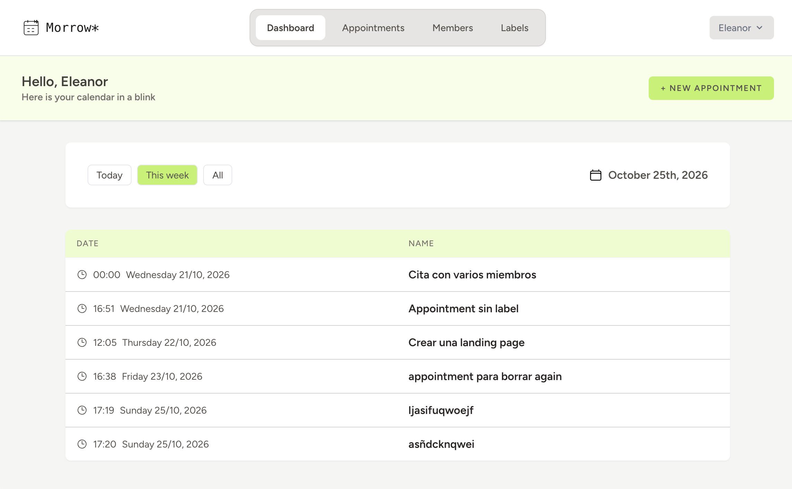
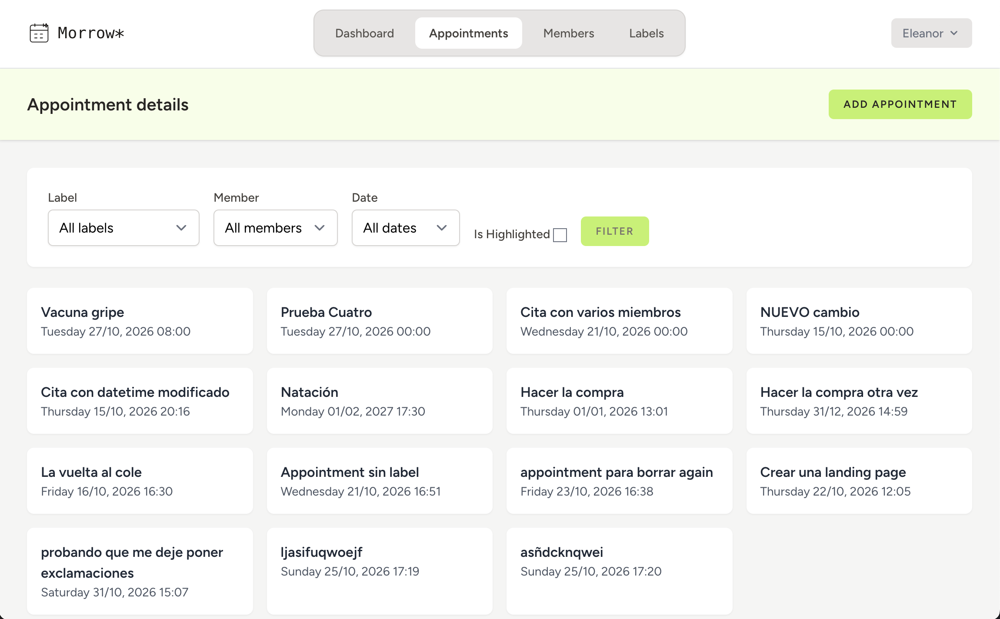
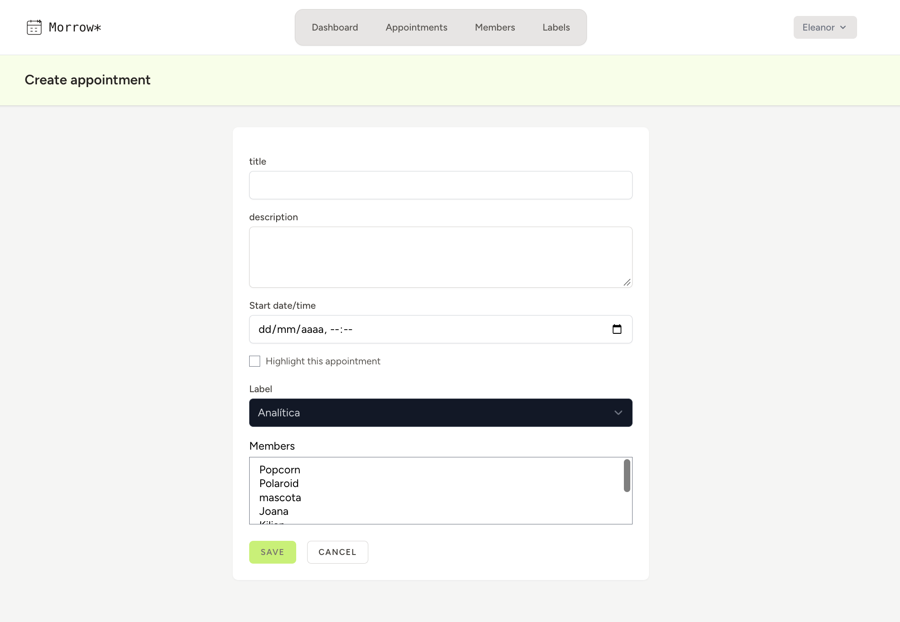
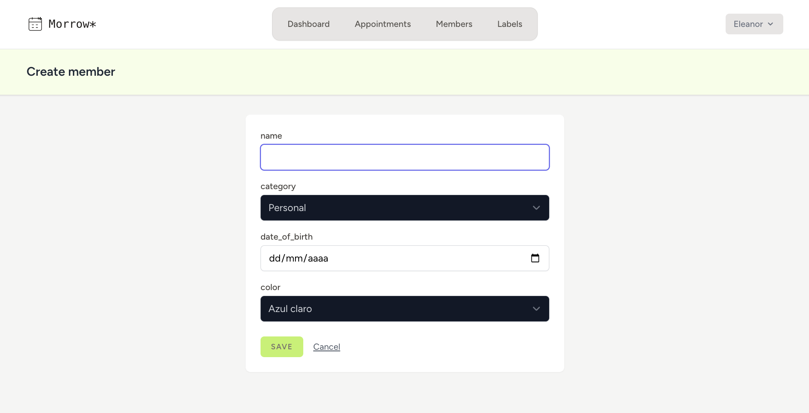
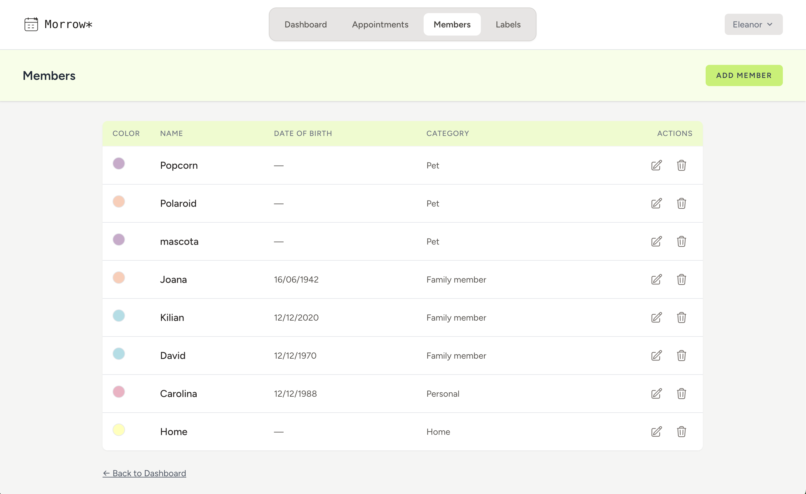
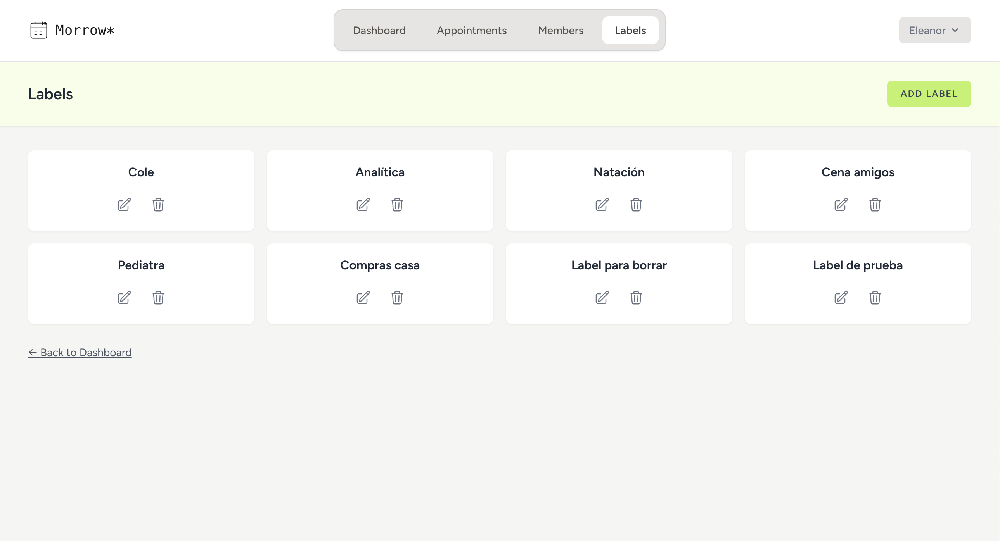

# Morrow

A personal calendar web application built with **Laravel** and **Laravel Breeze**. It lets each user organise appointments for the people (and things) in their life: themselves, family members, pets and the home.

> **Repository:** [github.com/cscmx/calendar](https://github.com/cscmx/calendar)

---

## Table of Contents

1. [About the Project](#about-the-project)
2. [Features](#features)
3. [Tech Stack](#tech-stack)
4. [Requirements](#requirements)
5. [Installation](#installation)
6. [First Steps After Installing](#first-steps-after-installing)
7. [Available Views](#available-views)
8. [Data Model](#data-model)
9. [Development Workflow](#development-workflow)
10. [Known Limitations and Roadmap](#known-limitations-and-roadmap)
11. [Author](#author)

---

## About the Project

Morrow gives a registered user a simple way to keep track of what is coming up. Each user manages three kinds of data:

- **Members**: the people or things appointments are about (yourself, a family member, a pet, the home). Each member has a category and a colour.
- **Labels**: short names to classify appointments (for example "Medical" or "School").
- **Appointments**: the events themselves. An appointment has one label and can involve one or several members.

The home page after logging in is a **dashboard** with a bird's-eye view of today's, this week's or all appointments.

---

## Features

- User registration, login and logout (Laravel Breeze).
- Full CRUD for **members**, **labels** and **appointments**.
- Appointments linked to **several members** at once (many-to-many) and to **one label**.
- **Dashboard** with "Today", "This week" and "All" filters, ordered by date and time.
- **Filters** on the appointments list by label, member, highlighted status and date (today, this week or all). They can be combined, and a "Clear filters" link resets them.
- Form validation with error messages under each field.
- Confirmation dialog before deleting a member, a label or an appointment.
- Colour-coded members and a highlight option for important appointments.

---

## Tech Stack

| Layer | Technology |
|---|---|
| Backend | PHP, Laravel |
| Authentication | Laravel Breeze (Blade) |
| Database | MySQL |
| Frontend | Blade templates, Tailwind CSS |
| Build tool | Vite |
| Icons | Heroicons (Blade components) |

---

## Requirements

Make sure you have the following installed before starting:

| Tool | Notes |
|---|---|
| **PHP** | Version 8.3 or higher (see `composer.json`) |
| **Composer** | To install PHP dependencies |
| **Node.js and npm** | To install and build the frontend assets (npm comes with Node.js). Developed with Node.js v26.4.0 |
| **MySQL** | A running MySQL server (MySQL Workbench is handy for checking the data) |
| **Git** | To clone the repository |

---

## Installation

### 1. Clone the repository

```bash
git clone https://github.com/cscmx/calendar.git
cd calendar
```

### 2. Install PHP dependencies

```bash
composer install
```

### 3. Create the environment file

```bash
cp .env.example .env
```

On Windows (Command Prompt) use `copy .env.example .env`.

### 4. Generate the application key

```bash
php artisan key:generate
```

### 5. Create the database

Create an empty MySQL database. The examples below use the name `calendar`, but any name works as long as it matches your `.env` file.

```sql
CREATE DATABASE calendar CHARACTER SET utf8mb4 COLLATE utf8mb4_unicode_ci;
```

### 6. Configure the `.env` file

The `.env.example` file is already set up for MySQL with a database called `calendar`. Open `.env` and fill in your own MySQL credentials:

```env
DB_USERNAME=your_mysql_user
DB_PASSWORD=your_mysql_password
```

If your database has a different name, change `DB_DATABASE` as well.

### 7. Run the migrations

```bash
php artisan migrate
```

This creates all the tables (users, members, labels, appointments, the appointment-member pivot table and the framework tables).

### 8. Install and build the frontend assets

```bash
npm install
```

For development, keep this running in a separate terminal so style changes apply immediately:

```bash
npm run dev
```

Or, for a one-off production build:

```bash
npm run build
```

### 9. Start the application

```bash
php artisan serve
```

Open **http://localhost:8000** in your browser.

> **Tip:** if the page loads without styles, make sure `npm run dev` is running (or run `npm run build` once).

---

## First Steps After Installing

An appointment needs a label and at least one member, so create the data in this order:

1. **Register** a new account from the landing page.
2. Create at least one **member** (for example, your own "personal" member).
3. Create at least one **label** (for example, "Medical").
4. Create your first **appointment**, choosing a label and one or more members.
5. Go back to the **dashboard** to see it listed.

---

## Available Views

### Public

| View | Route | Description |
|---|---|---|
| Landing page | `/` | Welcome page with logo, the slogan and Login / Register buttons |
| Login | `/login` | Sign in to an existing account |
| Register | `/register` | Create a new account |

### Authenticated

| Area | View | Route | Description |
|---|---|---|---|
| Dashboard | Dashboard | `/dashboard` | Table of appointments filtered by **Today** (default), **This week** or **All**, with the current date |
| Members | List | `/members` | Cards with all of the user's members, each one clickable to edit |
| Members | Create | `/members/create` | Form with name, date of birth, category and colour |
| Members | Edit | `/members/{id}/edit` | Edit a member or delete it |
| Labels | List | `/labels` | Cards with all labels, each one clickable to edit |
| Labels | Create | `/labels/create` | Form with the label name (unique) |
| Labels | Edit | `/labels/{id}/edit` | Edit a label or delete it |
| Appointments | List | `/appointments` | Appointment cards with combinable filters by label, member, highlighted status and date (today or this week), and a "Clear filters" link |
| Appointments | Create | `/appointments/create` | Form with title, description, start date and time, highlight option, label and members |
| Appointments | Details | `/appointments/{id}` | Full details of an appointment, with links to edit and delete |
| Appointments | Edit | `/appointments/{id}/edit` | Edit an appointment (fields preloaded) or delete it |
| Profile | Profile | `/profile` | Account settings provided by Breeze |


### Screenshots

| Dashboard | Appointments list |
|---|---|
|  |  |

| Create appointment | Create member |
|---|---|
|  |  |

| Members | Labels |
|---|---|
|  |  |

---

## Data Model

```
users 1 ──── * members * ──── * appointments * ──── 1 labels
                     (pivot: appointment_member)
```

| Table | Main fields | Notes |
|---|---|---|
| `users` | name, email, password | Created by Breeze. |
| `members` | user_id, name, date_of_birth, category, color | Belongs to a user. Category is one of `personal`, `family_member`, `pet`, `home`. Date of birth is required only for family members. Colour is a hex value (`#RRGGBB`). A member cannot be deleted while appointments use it |
| `labels` | name | Unique name. Independent of any user. A label cannot be deleted while appointments use it (an error message explains why).|
| `appointments` | title, description, start_date_time, end_date_time, is_highlighted, status, label_id | Belongs to one label. `end_date_time` is nullable. `status` is one of `scheduled`, `completed`, `cancelled` (default `scheduled`). |
| `appointment_member` | appointment_id, member_id | Pivot table. Composite primary key. Rows are removed in cascade when either side is deleted. |

---

## Development Workflow

The project follows a simple **git flow**:

- `dev` is the base branch and the default branch on GitHub.
- Each feature lives in its own branch named `feature/verb-resource` (for example `feature/create-appointment`).
- Features are merged into `dev` through pull requests.
- `main` is left untouched until the final delivery.

Commit messages follow a short convention: `feat:`, `fix:`, `refactor:` followed by a brief description.

---

## Known Limitations and Roadmap

Honest notes on what is not finished yet:

- **Data isolation between users:** every registered user can currently see all appointments in the database. Restricting each user to their own data is planned for the next sprint.
- **Default members:** the "personal" and "home" members are not created automatically at registration; each user creates their members manually.
- **`end_date_time` and `status`:** both columns exist in the database but are not used by the forms yet. Every appointment is saved as `scheduled`, and marking one as completed once its date has passed is pending.
- **Overlap warning:** a warning when a new appointment overlaps another one for the same member is planned but not implemented.
- **Member details page:** the `members.show` route, controller method and view exist but are not linked from the interface, since the members list already shows the same information. They are kept for a possible use in a future sprint.

---

## Author

**CAROLINA SAINZ**

- Repository: [github.com/cscmx/calendar](https://github.com/cscmx/calendar)
- Contact: https://www.linkedin.com/in/carolinasainz/
